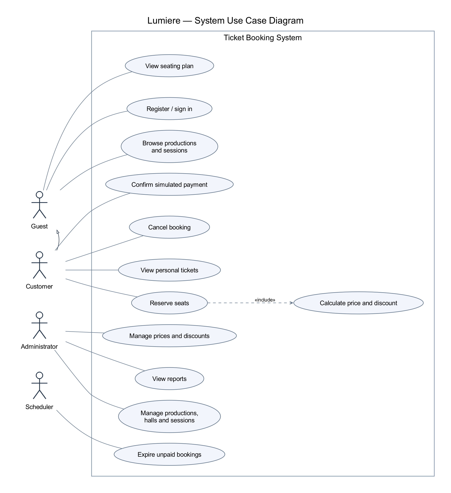

# 1. Domain Analysis and System Requirements

## Purpose and scope

Lumière is a theater and cinema ticket booking system. It helps customers discover events, choose seats and reserve or purchase tickets, while administrators manage the repertoire, schedules and prices and monitor sales.

A venue contains multiple halls. Each screening or performance (a session) belongs to one production and takes place in one hall. A production describes a film or play; a session specifies when and where it is shown. Each hall has numbered seats grouped into Standard, VIP and Balcony categories. Availability is tracked per session, since the same seat can be sold for different sessions.

A booking temporarily holds seats for a customer. A paid booking produces tickets; a cancelled or expired unpaid booking releases the seats. Booking items preserve the price and discount applied at the time of reservation, providing a reliable basis for sales reports.

The interface is Ukrainian, the currency is UAH, and local session times use Europe/Kyiv. Database timestamps use `timestamptz`; monetary amounts are stored as integer kopecks.

Payment is simulated for this coursework: confirmation records a sale without charging real money. Integration with a real payment provider and refunds of paid tickets are outside the initial scope. The requirements below describe the target system, not currently implemented features.

## Actors

| Actor | Responsibilities |
|---|---|
| Guest | Browse productions and sessions, view seating availability, register and sign in. |
| Customer | Use browsing features, reserve seats, apply eligible discounts, confirm simulated payment, view personal tickets and cancel personal unpaid bookings. |
| Administrator | Manage productions, halls, sessions, prices and discounts; view reports. |
| Scheduler | Trigger expiration of unpaid bookings and release reserved seats. It represents a time-triggering service outside the booking subsystem. |

## Functional requirements

| ID | Requirement | Acceptance criterion |
|---|---|---|
| FR-01 | Production catalog | Each film/play has a title, type, description and duration; only administrators can edit it. |
| FR-02 | Session schedule | Each session has start/end times, a hall and a production; sessions in the same hall cannot overlap. |
| FR-03 | Seating plan | Display rows, seat numbers, STANDARD/VIP/BALCONY categories and availability statuses. |
| FR-04 | Accounts | Support unique email addresses, password hashes, sign-in/out and CLIENT/ADMIN roles. |
| FR-05 | Reservation | An authenticated customer can reserve 1–8 seats for one future session. |
| FR-06 | Concurrent booking | Concurrent requests cannot reserve the same seat; conflicts return HTTP 409. |
| FR-07 | Cancellation | A customer can cancel their own active unpaid booking; its seats immediately become available. |
| FR-08 | Seat prices | Configure a price for each seat category in each session. |
| FR-09 | Discounts | Apply one eligible discount: a 10% student discount or an active promotion, whichever gives the lowest price. |
| FR-10 | Ticket sales | Simulated payment confirmation issues tickets; repeated confirmation does not duplicate sales. |
| FR-11 | Reports | Provide ticket sales by period, revenue by session/production and hall occupancy by day. |
| FR-12 | Administration | Provide an administrative interface to create/edit core entities, configure discounts and view reports. |

## Business rules

1. A booking lasts 15 minutes or until the session starts, whichever comes first. After this deadline, its status becomes EXPIRED and its seats are released.
2. A booking transitions from PENDING to PAID, CANCELLED or EXPIRED. These terminal states cannot be reversed in the initial version.
3. Each booking item stores its base price, discount amount and final price. Later price changes do not affect existing reservations.
4. Discounts do not stack. Student eligibility is an administrator-confirmed account flag for this coursework; real document verification is outside scope.
5. Percentage discounts are rounded to the nearest kopeck per seat. The server determines prices and discount eligibility rather than trusting client-supplied values.
6. SOLD indicates a paid ticket, RESERVED an active unpaid booking, and AVAILABLE a seat that can be booked.
7. Customers can access only their own bookings. Administrative operations require server-side role checks.
8. Historical sales are retained. Productions and sessions with history are archived rather than cascade-deleted.
9. Reporting periods use half-open intervals `[from, to)` with timezone-aware boundaries. Revenue includes only PAID bookings. Occupancy is sold seats divided by available capacity, multiplied by 100%; temporary reservations are reported separately. Daily occupancy uses total sold seats divided by total seat capacity across that day's sessions.

## Non-functional requirements

- Expose a REST JSON API with server-side input validation and consistent errors.
- Update reservations and seat inventory atomically using database transactions.
- Hash passwords, protect authentication cookies and keep secrets out of Git.
- Provide a responsive interface with keyboard-accessible seat selection and text labels in addition to status colors.
- Verify core workflows, authorization and concurrent booking using integration tests when those features are implemented.

## Main use case: reserve seats

**Actor:** Customer. **Preconditions:** the customer is signed in; the session has not started.

1. The customer selects a session and opens the current seating plan.
2. The customer selects 1–8 seats and optionally supplies a promotion code.
3. The server checks permissions, the session time, discount eligibility, prices and seat availability inside a transaction.
4. If every seat is available, the server creates the booking and reserves all selected seats.
5. The system returns the booking details, final price and expiration time.

**Alternative flow:** if any selected seat is unavailable, the entire operation is rejected with a conflict response. The customer refreshes the seating plan and chooses again.

**Postcondition:** all selected seats belong to one active booking, or no seats have been reserved by this request.

## Use case diagram

[Editable PlantUML source](use-cases.puml)
